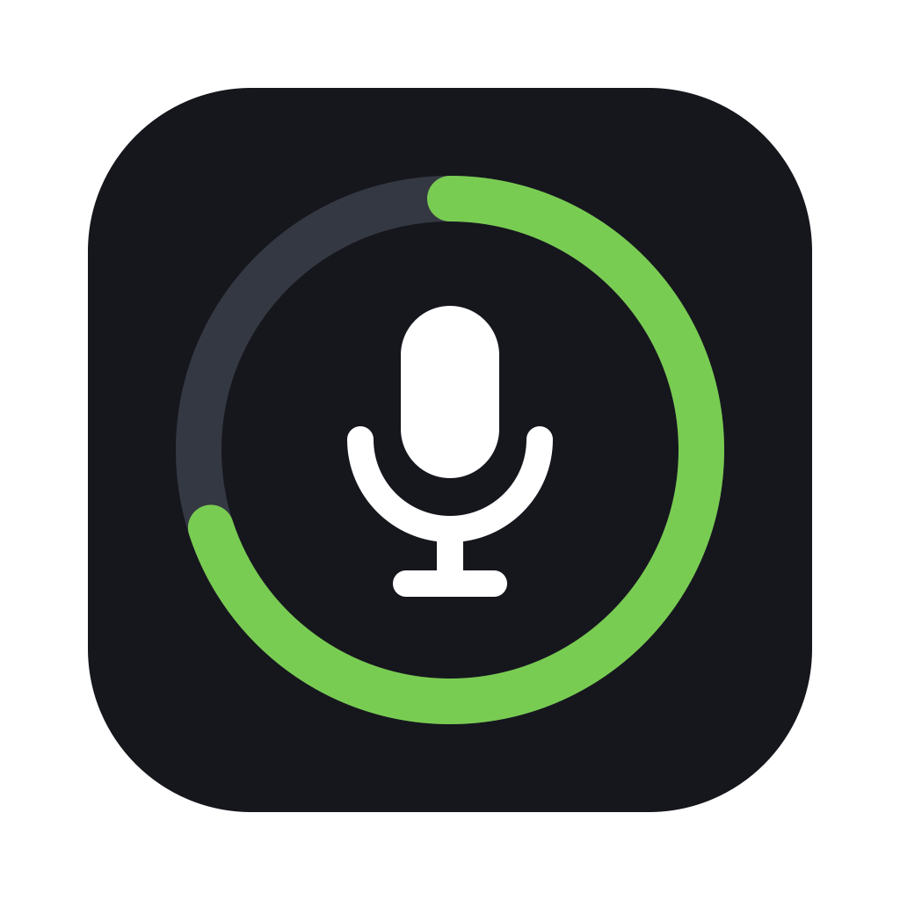
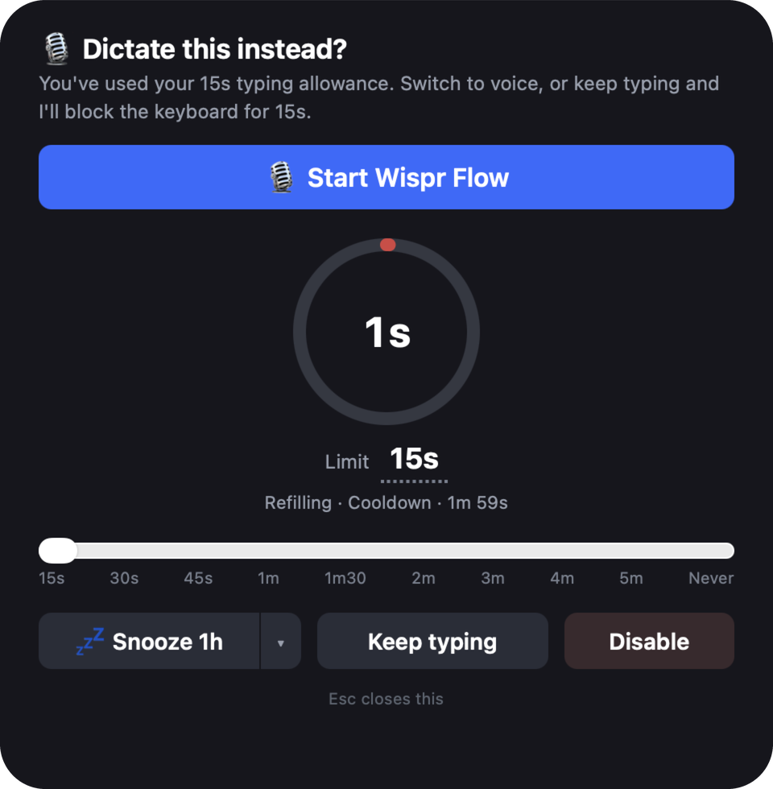
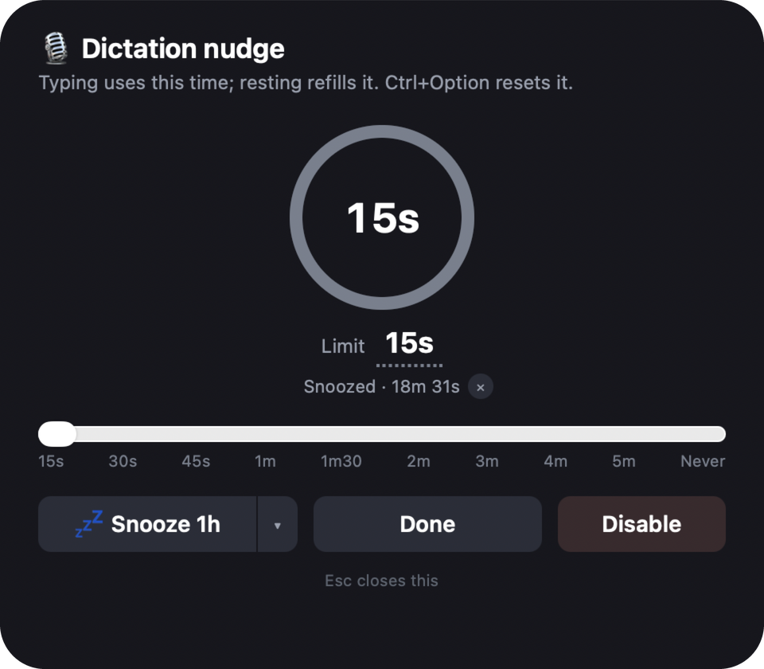
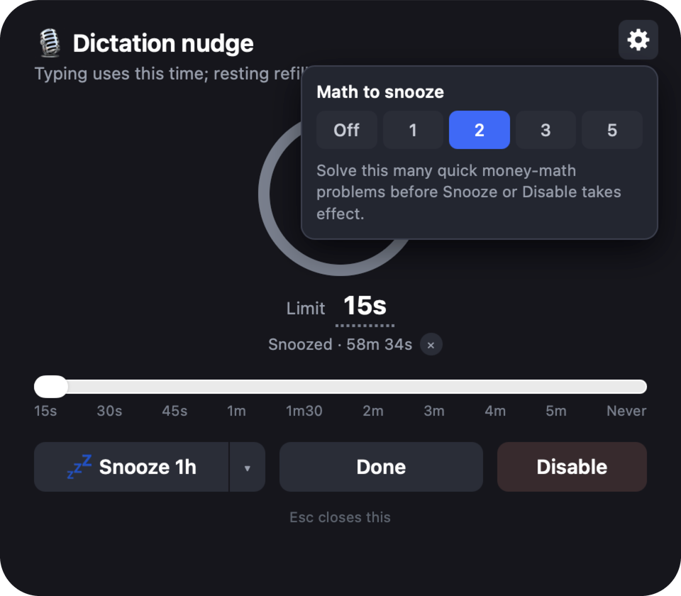
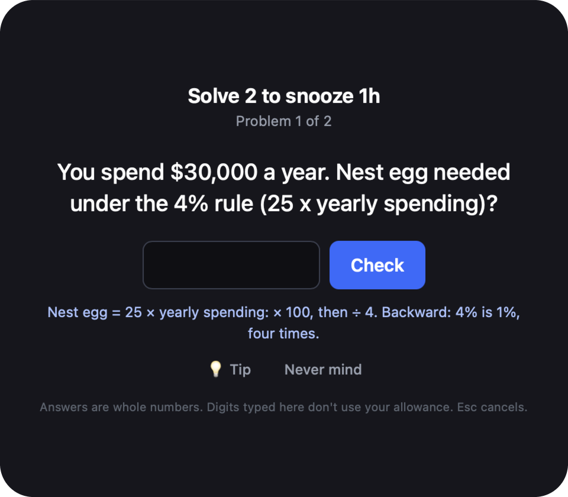

<p align="center">
  
</p>

# Dictation Nudge

A [Hammerspoon](https://www.hammerspoon.org/) module for macOS that notices when you have been typing for a while and nudges you to dictate instead.

Typing spends a small, refillable allowance. When it runs out you get a sound, a banner, and a card with a one-click button that starts your dictation app. Keep typing through that and the keyboard is blocked for a few seconds. Resting refills the allowance at the rate typing spends it, so it takes sustained typing to run it out.

<p align="center">
  
</p>

It is one Lua file with no dependencies beyond Hammerspoon, and a plain-Lua test suite that runs without macOS.

**Status:** a personal tool, shared as is. It runs every day on one machine (Hammerspoon 1.1.1, macOS 27.2) and has not been tested anywhere else.

## Why

If you have decided you would rather dictate long text than type it, the hard part is remembering at the moment your hands are already on the keyboard. A reminder on a timer is easy to ignore because it does not know whether you are typing. This one only speaks up while you are actually typing, and it gets out of the way the moment you stop.

The defaults point at [Wispr Flow](https://wisprflow.ai/), because that is what I use. Any dictation app that can be started from a URL or launched by name works; see [Configuration](#configuration).

## What it does

**Tier 1, the nudge.** When the allowance is used up, the next key you type triggers a system sound, a banner, and the card above. From the card you can start dictation, snooze, change the allowance, or dismiss it and keep typing. Esc closes it from any app.

**Tier 2, the lockdown.** If you keep typing for 12 more seconds without a real pause, the module tries to draw a dark overlay over each display and **swallows the key presses it receives for 15 seconds**. Esc ends it immediately (password fields are the exception; see [below](#what-it-reads-from-your-keyboard)). This is the part of the tool that does something *to* you, on purpose. If you do not want it, set `lockdownEnabled = false` and the tool stops at the card on its own.

**The card, any time.** Click the menubar item (or run the launcher app, or open a URL) to see the allowance, change the limit, snooze, or disable.

**The snooze gate, if you want one.** Snoozing can become a reflex. Turn on "Math to snooze" under the card's gear and Snooze and Disable first ask you a few short money-math problems. See [The snooze gate](#the-snooze-gate).

<p align="center">
  
  
</p>

The menubar shows the seconds you have left (`🎙 15s`), shading from green to red as the allowance drains. It reads `🎙 zZ 18m` while snoozed and `🎙 off` when disabled.

## What it reads from your keyboard

This tool installs an event tap that sees every key press macOS delivers to it, so it is fair to ask exactly what it does with them. The short version: it looks at each key press long enough to decide whether it counts as typing, and keeps a timestamp. Here is the long version. The [tests](#tests) check the parts of it that can be checked offline.

**What the tap listens to.** `keyDown` and `flagsChanged` (modifier) events, system-wide, for as long as Hammerspoon runs.

**What it can read from an event, in memory** (not every field on every event):

- the **event type**, to tell a key press from a modifier change
- the **keycode**, to recognize Esc and to skip keys that are not typing (arrows, Tab, function keys, any you add, and the digit keys while a snooze-gate problem is showing)
- the **modifier flags**, to skip Command and Control shortcuts and to notice the reset chord
- the **autorepeat flag**, to skip a key that is being held down

It never asks an event for the characters it would produce.

**What it keeps.** Timing, never keys. In memory it holds when the last counted key arrived, how many seconds of allowance are used, when the last nudge fired (for the cooldown and the lockdown countdown), and when a lockdown or snooze ends. No keycode, modifier, or character is stored, written to the Hammerspoon console, or sent anywhere.

**What the card's own text fields send.** The card has three fields you can type in: the limit, a custom snooze length, and the answer to a snooze-gate problem. That text does not come from the event tap. It is ordinary text in the card's web view, and the card hands the module the limit as a number and the other two as the text you typed. The module parses a snooze length into minutes, compares an answer with the expected number, and keeps neither string. While a snooze-gate challenge is open it holds that challenge's problems and your place in it; closing the card discards them.

**What it logs.** State changes, to the Hammerspoon console. For example: started, nudge fired, lockdown began or ended, snoozed, limit or snooze-gate count changed, dictation URL requested. Typing itself logs nothing. The text you type into the card's fields is never written to the log either; the snooze or setting change it leads to is logged like any other.

**What goes to disk.** Three preferences, through `hs.settings`: your allowance, your last snooze length, and the snooze-gate problem count.

**What goes over the network.** The module makes no network calls of its own, and the card is a local HTML string that loads nothing from outside. The one thing that leaves the module is the card's Start button, which asks macOS to open `dictationURL` with whatever app is registered for it. By default that is `wispr-flow://start-hands-free`, a hand-off to an app on your own machine. It is your setting: point it at a web address and it will open that address in your browser.

**What it changes about your input.** Two things, both deliberate:

- An Esc key press is consumed (the app behind does not get it) while the card or the lockdown is on screen.
- During the lockdown, every other key press is consumed.

Everything else passes through untouched, including modifier keys on their own and key releases.

**Where macOS overrides all of this.** While secure input is on (password fields are meant to turn it on), macOS does not deliver key events to event taps at all. So this module cannot see what you type there, and for the same reason the lockdown does not block typing there and Esc cannot dismiss it from there. That behavior belongs to macOS, not to this code.

**What this does not cover.** The permissions belong to Hammerspoon, not to this module. Once Hammerspoon has Accessibility and Input Monitoring, any Lua in your Hammerspoon config can read your keystrokes. This module is about 1,800 lines in one file; read it before you trust it, and treat the rest of your config the same way.

## Install

You need macOS and [Hammerspoon](https://www.hammerspoon.org/).

1. In **System Settings → Privacy & Security**, give Hammerspoon both **Accessibility** and **Input Monitoring**.
2. Put `dictation_nudge.lua` in `~/.hammerspoon/`. A symlink to a clone works and keeps it easy to update:

   ```bash
   git clone https://github.com/arkaigrowth/dictation-nudge.git
   ln -s "$PWD/dictation-nudge/dictation_nudge.lua" ~/.hammerspoon/dictation_nudge.lua
   ```

3. Add this to `~/.hammerspoon/init.lua`:

   ```lua
   local ok, dictation_nudge = pcall(require, "dictation_nudge")
   if ok then dictation_nudge.start({}) end
   ```

4. Reload the Hammerspoon config. `🎙 15s` appears in the menubar.

**Check that it can see typing.** A missing Input Monitoring grant fails silently: the tap starts but never receives anything. With the tool freshly loaded (not snoozed, not disabled, limit not on Never), type a few ordinary letters into any normal text field, then run this in the Hammerspoon console:

```lua
dictationNudgeStatus()
-- tap=true threshold=15s used=0.4s lastCountedKeyAge=1.2s lockdown=off snooze=off card=closed disabled=false
```

`lastCountedKeyAge` is the age of the last key that counted as typing since the meter was last reset (a reload, a snooze, a limit change, or the reset chord all reset it). If it still says `never seen` after you typed plain letters, the tap is probably not receiving your keys. A missing Input Monitoring grant is one cause: grant it, then quit and reopen Hammerspoon.

`dictationNudgeTest()` previews the nudge card so you can see it without typing for 15 seconds. A preview does not start the cooldown or arm the lockdown.

### Optional: a launcher app

`launcher/` holds a few lines of AppleScript and a build script that turns it into `Dictation Nudge.app`, so you can open the card from Spotlight, Raycast, or the Dock. The app only opens `hammerspoon://dictationNudgeSettings`. No binary is checked in; you build it locally with tools that ship with macOS:

```bash
./launcher/build.sh /Applications
```

Running it again replaces a launcher it built before, which it recognizes by a marker file it stamps into its builds. It refuses to touch anything else with that name; move that out of the way yourself first.

## Configuration

Pass overrides to `start`. Anything you leave out keeps its default. An option it does not know, or a value of the wrong type or shape, makes `start` raise an error before it installs anything.

```lua
dictation_nudge.start({
  nudgeAfterSeconds = 30,
  lockdownEnabled   = false,
  dictationName     = "My Dictation App",
  dictationURL      = false,              -- launch the app by name instead of opening a URL
  resetModifiers    = { "fn" },           -- match your dictation hotkey
  extraExcludedKeys = { "delete", "return" },
})
```

| Option | Default | What it does |
|---|---|---|
| `nudgeAfterSeconds` | `15` | The typing allowance. `-1` turns nudges off. Once you change the limit on the card, the saved value wins over this. |
| `refillDelaySeconds` | `0.25` | How long a pause has to be before the allowance starts refilling. Also the most a single gap between two keys can cost. |
| `refillPerSecond` | `1` | Seconds of allowance restored per second of rest. |
| `gapSeconds` | `3` | A pause longer than this ends the burst and calls off a pending lockdown. |
| `cooldownSeconds` | `120` | Minimum time between two nudges. |
| `escalateAfterSeconds` | `12` | How long you can keep typing after the nudge before the lockdown. |
| `lockdownSeconds` | `15` | How long the lockdown lasts. |
| `lockdownEnabled` | `true` | `false` turns the automatic lockdown off. (The `dictationNudgeLock()` console helper still starts one on request.) |
| `soundName` | `"Glass"` | System sound for the nudge. `false` for silence. |
| `dictationName` | `"Wispr Flow"` | The name shown on the card, the banner, and the overlay. |
| `dictationURL` | `"wispr-flow://start-hands-free"` | Opened by the card's Start button. `false` launches the app called `dictationName` instead. |
| `resetModifiers` | `{"ctrl", "alt"}` | Holding these modifiers, with no other of Command, Control, Option, or Shift, refills the allowance at once. Fn is only checked if you list it. Set it to your dictation hotkey so starting to dictate clears the meter. `false` turns it off. |
| `extraExcludedKeys` | `{}` | Extra keys that never count as typing, by [`hs.keycodes.map`](https://www.hammerspoon.org/docs/hs.keycodes.html#map) name. |
| `snoozeMinutes` | `30` | Default snooze length. The last length you picked wins over this. |
| `snoozeMathProblems` | `0` | Money-math problems to solve before Snooze or Disable takes effect, `0` to `10`. `0` is off. Once you set it on the card, the saved value wins over this. See [The snooze gate](#the-snooze-gate). |
| `menubarEnabled` | `true` | `false` hides the menubar item. |
| `menubarAutosaveName` | `"DictationNudge"` | The name macOS files the menubar item's position under. |

The Wispr Flow URL is the one that works on my install. It is not something this project controls, and it may change.

## Controls

| Where | What |
|---|---|
| Menubar item | Click to open the card. |
| Card | Start dictation, change the limit (drag the slider, or click the limit and type `20s`, `2 min`, `1m30s`), snooze with a preset or a typed length, end a snooze with the ✕, disable for the session. |
| Card, ▾ next to Snooze | Presets, or **Custom…** to type a length in minutes and hours: `45m`, `90`, `1.5h`, `1h 30m`, `2 hours`, `1:30`, `an hour and a half`. A bare number is minutes. One minute to 12 hours, decimals to four places, nothing rounded. Days and longer are refused, as is anything it cannot read exactly. |
| Card, gear in the corner | "Math to snooze": how many problems the [snooze gate](#the-snooze-gate) asks. The gear is tinted while the gate is on. |
| Esc | Closes the card or ends the lockdown, from any app. |
| Reset chord | Hold Control+Option (configurable) to refill the allowance. |
| `hammerspoon://dictationNudgeSettings` | Opens the card. |
| `hammerspoon://dictationNudgeSnooze` | Toggles snooze. With the snooze gate on, starting a snooze this way opens the card on the first problem instead. |
| `hammerspoon://dictationNudgeTest` | Previews the nudge card (no cooldown, no lockdown). |

Disable is for the current session only: reloading Hammerspoon turns the tool back on. To turn it off for good, drag the limit to **Never**.

Console helpers, for the Hammerspoon console (or the `hs` command line tool, if you have installed it and load `hs.ipc`): `dictationNudgeStatus()`, `dictationNudgeSettings()`, `dictationNudgeTest()`, `dictationNudgeSnooze()`, `dictationNudgeDisable()`, `dictationNudgeLock()` (starts a real lockdown now, even with `lockdownEnabled = false`, as long as the tap is enabled so Esc can end it), and `dictationNudgeFilterTest()` (builds a few key events in memory, posts nothing, and reports how the filter classifies them).

## How the allowance works

The meter charges for typing, not for time passing.

- **Only the gap between two counted keys is charged**, and at most 0.25 seconds of it. A single key on its own costs nothing.
- **Resting refills it.** After 0.25 seconds without a counted key, the allowance comes back at one second per second.
- **Steady typing drains it in real time.** At normal typing speed the gaps are well under 0.25 seconds, so 15 seconds of typing uses 15 seconds of allowance.
- **Slow typing does not drain it.** Each gap costs at most 0.25 seconds and everything past that refills, so at about two keys per second you break even, and slower than that you gain. The tool is tuned to catch sustained prose, not hunting for a key.
- **A pause longer than 3 seconds ends the burst.** Nothing is charged for it, and a pending lockdown is called off. It does not reset the meter: whatever has not refilled yet carries into the next burst, so two 10-second bursts four seconds apart will reach a 15-second limit.
- **A nudge needs a key.** The nudge fires on the counted key that uses up the allowance, and only if the last nudge was at least two minutes ago. Idle time never fires one.
- **The lockdown follows the nudge.** After a nudge, if you keep typing with no pause longer than 3 seconds, the first counted key at or after 12 seconds starts the lockdown. Dismissing the card does not cancel this; pausing, snoozing, or the reset chord does.

Keys that never count, and never break a burst either: a held key repeating, anything typed with Command or Control down, F1 to F20, the arrow keys, Tab, and whatever you list in `extraExcludedKeys`. Shift and Option combinations count, because capitals and accented characters are typing. While a snooze-gate problem is on screen, the keys you need to answer it (digits, period, comma, minus, Delete, Return) do not count either.

The meter is timestamp arithmetic, done when a key arrives or when the display asks; nothing ticks in the background to maintain it. The displays do use timers: the menubar item refreshes twice a second while the allowance is below full, and the card four times a second while it is open.

## The snooze gate

Off by default. It exists because a snooze button one click away from the nudge is easy to hit without deciding to.

Open the gear in the card's corner and set **Math to snooze** to 1, 2, 3, or 5 (or set `snoozeMathProblems` in your config, up to 10). From then on, Snooze and Disable show that many short problems first, one at a time, and the snooze or disable happens only after the last correct answer.

<p align="center">
  
  
</p>

**The problems** are everyday money math you can do in your head, drawn at random from 23 kinds: tips, discounts, and sales tax; percent change; the rule of 72; a month of credit card interest; what a subscription or a daily habit costs per year; hourly rate to salary and back; savings rate; splitting a bill; the 4% rule; an employer match; two years of compounding; profit margin; months of runway; payback time; fund fees; the gain needed to recover from a loss; return after inflation; a contractor's tax set-aside; a raise after tax; a down payment. Every answer is a whole number. `$1,200`, `1200`, and `15%` are all read as numbers. The number has to be exact. A wrong answer gets a one-line hint about the method, never the answer, and you can try again as often as you like.

**Tip** shows the mental-math shortcut for the kind of problem on screen, such as "10% = move the decimal one place left. 5% = half of that." or "Years to double ≈ 72 ÷ the rate in percent." It is there to be used: the point of the gate is a moment of thought, and getting faster at this arithmetic is a fine way to spend it. A tip is fixed for its kind of problem. It can name common rates and rule constants, but neither a tip nor a hint contains a number the card would accept as the answer.

**What is gated:** the card's Snooze button and its presets, a typed snooze length, the card's Disable button, and starting a snooze through the `dictationNudgeSnooze` URL or console helper.

**What is not gated:** ending a snooze, turning the tool back on, Keep typing, the limit (including Never), `dictationNudgeDisable()` in the console, and the Math to snooze setting itself, which you can turn down or off in two clicks. This is friction for a reflex. It is not a lock, and it does not try to be one.

**Giving up** is always allowed: Never mind returns to the card, and Esc closes it. Either way nothing is snoozed. A new nudge card also replaces an unfinished challenge.

**Typing the answer is free.** While a problem is showing, digits and the other answer keys do not spend allowance, so solving the problem cannot itself trigger the lockdown. Letters still count, wherever you type them, so leaving a problem on screen does not switch the meter off.

## Tests

```bash
brew install lua@5.4
"$(brew --prefix lua@5.4)/bin/lua" tests/run.lua
# 77 tests, 77 passed, 0 failed
```

The suite needs only Lua 5.4, the version Hammerspoon embeds, and I have not run it on any other. Homebrew's `lua@5.4` is not put on your `PATH`, hence the full path above; if your own `lua` is already 5.4, `lua tests/run.lua` is enough. It loads the real module against `tests/hs_stub.lua`, a stand-in for the Hammerspoon API with a fake clock, and drives the real event-tap callback. It never creates or posts a key event.

What it covers: the allowance arithmetic, when each tier fires, the cooldown, the lockdown swallowing keys and ending on Esc or on time (including when drawing the overlay fails or its timer never fires), the key filters, the reset chord, snooze, disable, saved preferences, config validation, and malformed messages from the card. For the snooze gate: that nothing is snoozed or disabled until every problem is answered, that an answer counts only for the problem it was sent for, what is and is not gated, that answer keys spend nothing, and that a card which stops responding or fails to load while a problem is up is closed, which drops the problem. The typed snooze lengths are checked against a table of accepted and refused inputs. The money-math bank is checked two ways: one hand-worked case per kind of problem, and a walk over every problem the bank can produce (several hundred) that requires a positive whole-number answer, and a hint and a tip with no number in them that would be accepted as that answer.

It also checks the claims in [What it reads from your keyboard](#what-it-reads-from-your-keyboard):

- The fake key event raises an error if the module calls anything other than the type, keycode, flags, or autorepeat accessors.
- A run of varied typing through both tiers must produce exactly three fixed log lines, in order (nudge fired, lockdown began, lockdown ended), no settings writes, and no opened URLs.
- Only the three preference keys are ever written, with the values that were set.
- The text of a snooze-gate answer is never logged, saved, or sent back to the card. The test checks that a rejected answer writes no log line and no setting, and that in a plain gated snooze the final correct answer produces one log line (the snooze) and one settings write (the snooze length).
- The card's HTML is scanned for anything that would load from outside, and the source for character, network, file, shell, clipboard, and dynamic-code APIs.

The last check is a text scan. It guards against the obvious regressions; it is not a proof, and it is no substitute for reading the file.

What it does not cover: anything that needs the real Hammerspoon. The card's HTML and JavaScript (including the limit field's duration parser, the gear, how a problem is displayed, the Tip button, and that the controls behind a problem cannot be reached while it is up), the menubar item's appearance, the overlay on real displays, and the permission prompts are checked by hand.

## Limitations

- **macOS and Hammerspoon only**, and tested on a single machine. Other macOS or Hammerspoon versions may behave differently.
- **Two permissions are required**, and Input Monitoring fails silently when it is missing. Use `dictationNudgeStatus()` to check.
- **The tap is global.** The module does not know which app or field you are typing in. It cannot exempt a code editor or a terminal; use snooze or the reset chord for that.
- **The lockdown blocks key presses, nothing else**, and not in secure-input fields (see above). A note in the code says the overlay may not draw over an app in its own full-screen Space. I have not verified this either way. If it happens, keys are still blocked for the 15 seconds and Esc still ends it.
- **The block lives in Hammerspoon's event tap.** Quitting or reloading Hammerspoon removes it.
- **The URL events are open to anything on your machine.** Any local app, or a web page after your browser asks for confirmation, can open a `hammerspoon://` URL. For this module that means opening the card, toggling snooze, or previewing the nudge (with its sound). No URL starts or arms the lockdown, changes the limit, or returns any information. With the snooze gate on, the snooze URL cannot start a snooze by itself; it opens the card on a problem.
- **The menubar item can be hidden by macOS or a menubar manager.** If you do not see it, check that Hammerspoon is allowed in the menubar in System Settings.

## Not affiliated

Wispr Flow is a third-party product. This project is not affiliated with, endorsed by, or supported by its makers, and the same goes for Hammerspoon and Raycast. Names are used only to say what the tool works with.

## License

[MIT](LICENSE)
