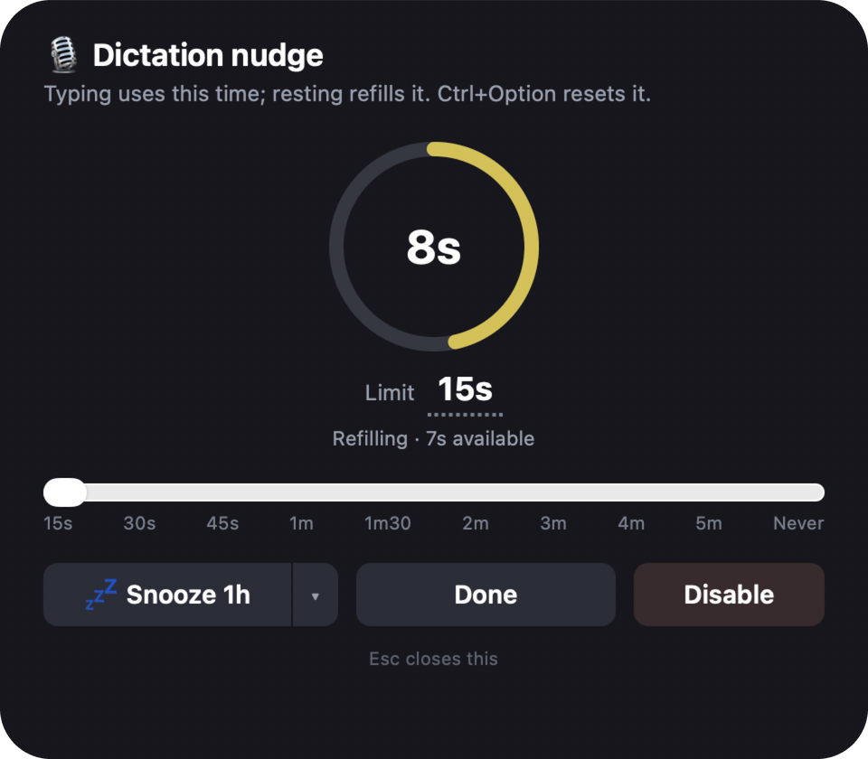

<p align="center">
  
</p>

# Dictation Nudge

A [Hammerspoon](https://www.hammerspoon.org/) module for macOS that notices when you have been typing for a while and nudges you to dictate instead.

Typing spends a small, refillable allowance. When it runs out you get a sound, a banner, and a card with a one-click button that starts your dictation app. Keep typing through that and the keyboard is blocked for a few seconds. Pausing refills the allowance, so short bursts of typing never trigger anything.

<p align="center">
  
</p>

It is one Lua file with no dependencies beyond Hammerspoon, and a plain-Lua test suite that runs without macOS.

**Status:** a personal tool, shared as is. It runs every day on one machine (Hammerspoon 1.1.1, macOS 27.2) and has not been tested anywhere else.

## Why

If you have decided you would rather dictate long text than type it, the hard part is remembering at the moment your hands are already on the keyboard. A reminder on a timer is easy to ignore because it does not know whether you are typing. This one only speaks up while you are actually typing, and it gets out of the way the moment you stop.

The defaults point at [Wispr Flow](https://wisprflow.ai/), because that is what I use. Any dictation app that can be started from a URL or launched by name works; see [Configuration](#configuration).

## What it does

**Tier 1, the nudge.** When the allowance is used up, the next key you type triggers a system sound, a banner, and the card above. From the card you can start dictation, snooze, change the allowance, or dismiss it and keep typing. Esc closes it from any app.

**Tier 2, the lockdown.** If you keep typing for 12 more seconds without a real pause, a dark overlay covers every display and **the module swallows your keystrokes for 15 seconds**. Esc ends it immediately. This is the part of the tool that does something *to* you, on purpose. If you do not want it, set `lockdownEnabled = false` and the tool stops at the card.

**The card, any time.** Click the menubar item (or run the launcher app, or open a URL) to see the allowance, change the limit, snooze, or disable.

<p align="center">
  
  
</p>

The menubar shows the seconds you have left (`🎙 15s`), shading from green to red as the allowance drains. It reads `🎙 zZ 18m` while snoozed and `🎙 off` when disabled.

## What it reads from your keyboard

This tool installs an event tap that sees every key press, so it is fair to ask exactly what it does with them. The short version: it looks at each key press long enough to decide whether it counts as typing, and keeps a timestamp. Here is the long version, and each point is checked by the test suite.

**What the tap listens to.** `keyDown` and `flagsChanged` (modifier) events, system-wide, for as long as Hammerspoon runs.

**What it reads from each event, in memory:**

- the **keycode**, to recognize Esc and to skip keys that are not typing (arrows, Tab, function keys, and any you add)
- the **modifier flags**, to skip Command and Control shortcuts and to notice the reset chord
- the **autorepeat flag**, to skip a key that is being held down

It never asks an event for the characters it would produce.

**What it keeps.** Two numbers about your typing: the time of the last counted key, and how many seconds of allowance are used. No keycode, modifier, or character is stored, written to the Hammerspoon console, or sent anywhere.

**What goes to disk.** Two preferences, through `hs.settings`: your allowance and your last snooze length.

**What goes over the network.** Nothing. The module makes no network calls. The card is a local HTML string in a webview and loads no remote content. The "Start" button opens one URL on your own machine (by default `wispr-flow://start-hands-free`) to hand off to your dictation app.

**What it changes about your input.** Two things, both deliberate:

- Esc is consumed (the app behind does not get it) while the card or the lockdown is on screen.
- During the lockdown, every key press except Esc is consumed.

Everything else passes through untouched.

**What this does not cover.** The permissions belong to Hammerspoon, not to this module. Once Hammerspoon has Accessibility and Input Monitoring, any Lua in your Hammerspoon config can read your keystrokes. This module is about 1,100 lines in one file; read it before you trust it, and treat the rest of your config the same way.

macOS stops delivering key events to event taps while secure input is on, which is how password fields are meant to work. That protection comes from macOS, not from this code.

## Install

You need macOS and [Hammerspoon](https://www.hammerspoon.org/).

1. In **System Settings → Privacy & Security**, give Hammerspoon both **Accessibility** and **Input Monitoring**.
2. Put `dictation_nudge.lua` in `~/.hammerspoon/`. A symlink to a clone works and keeps it easy to update:

   ```bash
   git clone https://github.com/arkaigrowth/dictation-nudge.git
   ln -s "$PWD/dictation-nudge/dictation_nudge.lua" ~/.hammerspoon/dictation_nudge.lua
   ```

3. Add this to `~/.hammerspoon/init.lua`:

   ```lua
   local ok, dictation_nudge = pcall(require, "dictation_nudge")
   if ok then dictation_nudge.start({}) end
   ```

4. Reload the Hammerspoon config. `🎙 15s` appears in the menubar.

**Check that it can see typing.** A missing Input Monitoring grant fails silently: the tap starts but never fires. Type a few characters anywhere, then run this in the Hammerspoon console:

```lua
dictationNudgeStatus()
-- tap=true threshold=15s used=0.4s lastKeyAge=1.2s lockdown=off snooze=off card=closed disabled=false
```

If `lastKeyAge` says `never seen` after you have typed, Input Monitoring is not granted. Grant it, then quit and reopen Hammerspoon.

`dictationNudgeTest()` fires the nudge card so you can see it without typing for 15 seconds.

### Optional: a launcher app

`launcher/` holds a few lines of AppleScript and a build script that turns it into `Dictation Nudge.app`, so you can open the card from Spotlight, Raycast, or the Dock. The app only opens `hammerspoon://dictationNudgeSettings`. No binary is checked in; you build it locally with tools that ship with macOS:

```bash
./launcher/build.sh /Applications
```

## Configuration

Pass overrides to `start`. Anything you leave out keeps its default.

```lua
dictation_nudge.start({
  nudgeAfterSeconds = 30,
  lockdownEnabled   = false,
  dictationName     = "My Dictation App",
  dictationURL      = false,              -- launch the app by name instead of opening a URL
  resetModifiers    = { "fn" },           -- match your dictation hotkey
  extraExcludedKeys = { "delete", "return" },
})
```

| Option | Default | What it does |
|---|---|---|
| `nudgeAfterSeconds` | `15` | The typing allowance. `-1` turns nudges off. Once you change the limit on the card, the saved value wins over this. |
| `refillDelaySeconds` | `0.25` | How long a pause has to be before the allowance starts refilling. Also the most a single gap between two keys can cost. |
| `refillPerSecond` | `1` | Seconds of allowance restored per second of rest. |
| `gapSeconds` | `3` | A pause longer than this ends the burst and calls off a pending lockdown. |
| `cooldownSeconds` | `120` | Minimum time between two nudges. |
| `escalateAfterSeconds` | `12` | How long you can keep typing after the nudge before the lockdown. |
| `lockdownSeconds` | `15` | How long the lockdown lasts. |
| `lockdownEnabled` | `true` | `false` removes the lockdown entirely. |
| `soundName` | `"Glass"` | System sound for the nudge. `false` for silence. |
| `dictationName` | `"Wispr Flow"` | The name shown on the card, the banner, and the overlay. |
| `dictationURL` | `"wispr-flow://start-hands-free"` | Opened by the card's Start button. `false` launches the app called `dictationName` instead. |
| `resetModifiers` | `{"ctrl", "alt"}` | Holding exactly these modifiers refills the allowance at once. Set it to your dictation hotkey so starting to dictate clears the meter. `false` turns it off. |
| `extraExcludedKeys` | `{}` | Extra keys that never count as typing, by [`hs.keycodes.map`](https://www.hammerspoon.org/docs/hs.keycodes.html#map) name. |
| `snoozeMinutes` | `30` | Default snooze length. The last length you picked wins over this. |
| `menubarEnabled` | `true` | `false` hides the menubar item. |
| `menubarAutosaveName` | `"DictationNudge"` | The name macOS files the menubar item's position under. |

The Wispr Flow URL is the one that works on my install. It is not something this project controls, and it may change.

## Controls

| Where | What |
|---|---|
| Menubar item | Click to open the card. |
| Card | Start dictation, change the limit (drag the slider, or click the limit and type `20s`, `2 min`, `1m30s`), snooze with a preset or custom length, end a snooze with the ✕, disable for the session. |
| Esc | Closes the card or ends the lockdown, from any app. |
| Reset chord | Hold Control+Option (configurable) to refill the allowance. |
| `hammerspoon://dictationNudgeSettings` | Opens the card. |
| `hammerspoon://dictationNudgeSnooze` | Toggles snooze. |
| `hammerspoon://dictationNudgeTest` | Fires the nudge card. |

Disable is for the current session only: reloading Hammerspoon turns the tool back on. To turn it off for good, drag the limit to **Never**.

Console helpers, for the Hammerspoon console or the `hs` command line tool: `dictationNudgeStatus()`, `dictationNudgeSettings()`, `dictationNudgeTest()`, `dictationNudgeSnooze()`, `dictationNudgeDisable()`, `dictationNudgeLock()` (starts the lockdown now), and `dictationNudgeFilterTest()` (builds a few key events in memory, posts nothing, and reports how the filter classifies them).

## How the allowance works

The meter charges for typing, not for time passing.

- **Only the gap between two counted keys is charged**, and at most 0.25 seconds of it. A single key on its own costs nothing.
- **Resting refills it.** After 0.25 seconds without a counted key, the allowance comes back at one second per second.
- **Steady typing drains it in real time.** At normal typing speed the gaps are well under 0.25 seconds, so 15 seconds of typing uses 15 seconds of allowance.
- **Slow typing does not drain it.** Each gap costs at most 0.25 seconds and everything past that refills, so at about two keys per second you break even, and slower than that you gain. The tool is tuned to catch sustained prose, not hunting for a key.
- **A pause longer than 3 seconds ends the burst.** Nothing is charged for it, and a pending lockdown is called off.
- **A nudge needs a key.** The nudge fires on the counted key that uses up the allowance, and only if the last nudge was at least two minutes ago. Idle time never fires one.
- **The lockdown follows the nudge.** After a nudge, if you keep typing with no pause longer than 3 seconds, the first counted key at or after 12 seconds starts the lockdown. Dismissing the card does not cancel this; pausing, snoozing, or the reset chord does.

Keys that never count, and never break a burst either: a held key repeating, anything typed with Command or Control down, F1 to F20, the arrow keys, Tab, and whatever you list in `extraExcludedKeys`. Shift and Option combinations count, because capitals and accented characters are typing.

All of this is timestamp arithmetic done when a key arrives or when the display asks. There is no background timer running while you type.

## Tests

```bash
lua tests/run.lua
# 38 tests, 38 passed, 0 failed
```

The suite needs only Lua 5.4 (`brew install lua`). It loads the real module against `tests/hs_stub.lua`, a stand-in for the Hammerspoon API with a fake clock, and drives the real event-tap callback. It never creates or posts a key event.

What it covers: the allowance arithmetic, when each tier fires, the cooldown, the lockdown swallowing keys and ending on Esc or on time, the key filters, the reset chord, snooze, disable, and saved preferences.

It also checks the claims in [What it reads from your keyboard](#what-it-reads-from-your-keyboard):

- The fake key event raises an error if the module calls anything other than the type, keycode, flags, or autorepeat accessors.
- Ordinary typing must produce no log lines and no settings writes.
- The source is scanned for character, network, file, shell, clipboard, and dynamic-code APIs.

What it does not cover: anything that needs the real Hammerspoon. The card's HTML and JavaScript (including the duration parser), the menubar item's appearance, the overlay on real displays, and the permission prompts are checked by hand.

## Limitations

- **macOS and Hammerspoon only**, and tested on a single machine. Other macOS or Hammerspoon versions may behave differently.
- **Two permissions are required**, and Input Monitoring fails silently when it is missing. Use `dictationNudgeStatus()` to check.
- **The tap is global.** The module does not know which app or field you are typing in. It cannot exempt a code editor or a terminal; use snooze or the reset chord for that.
- **The lockdown blocks key presses, nothing else.** A note in the code says the overlay may not draw over an app in its own full-screen Space. I have not verified this either way. If it happens, keys are still blocked for the 15 seconds and Esc still ends it.
- **The block lives in Hammerspoon's event tap.** Quitting or reloading Hammerspoon removes it.
- **The URL events are open to anything on your machine.** Any local app, or a web page after your browser asks for confirmation, can open a `hammerspoon://` URL. For this module that means opening the card, toggling snooze, or firing a test nudge. No URL starts the lockdown, changes the limit, or returns any information.
- **The menubar item can be hidden by macOS or a menubar manager.** If you do not see it, check that Hammerspoon is allowed in the menubar in System Settings.

## Not affiliated

Wispr Flow is a third-party product. This project is not affiliated with, endorsed by, or supported by its makers, and the same goes for Hammerspoon and Raycast. Names are used only to say what the tool works with.

## License

[MIT](LICENSE)
